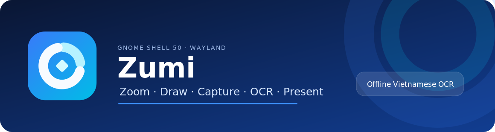
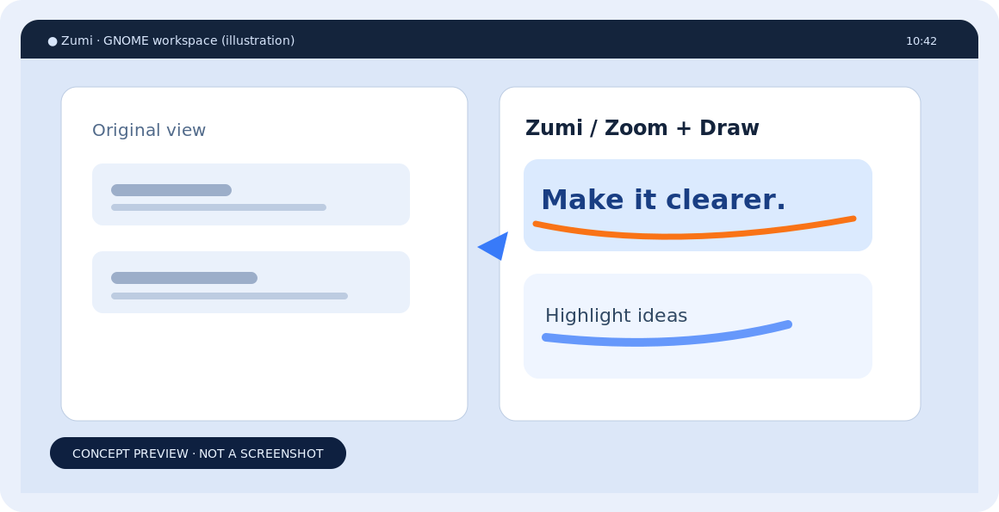
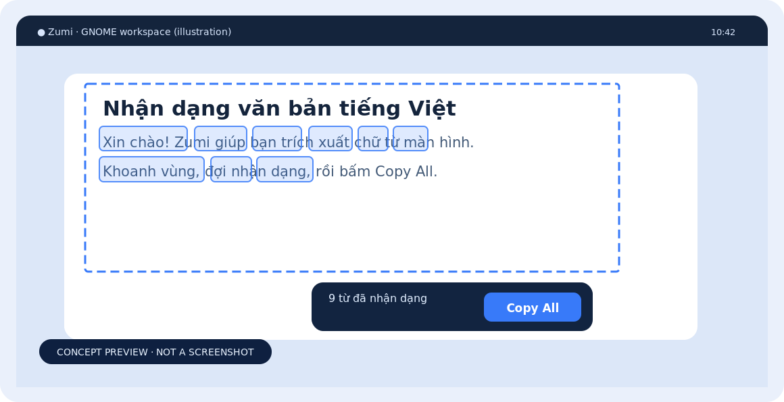
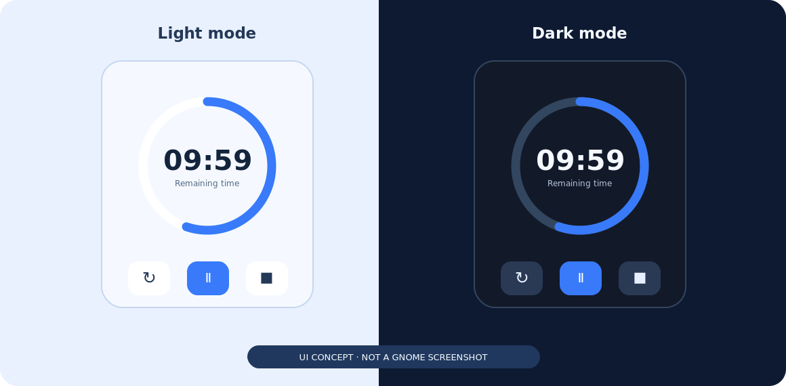

<div align="center">



# Zumi

**Screen tools for GNOME Shell 50 on Wayland.**  
Zoom, draw, highlight the cursor, record, capture and extract Vietnamese/English text — from one extension.

[Tiếng Việt](README.vi.md) · [Features](#features) · [Installation](#installation) · [Shortcuts](#keyboard-shortcuts) · [Publishing](#publishing)

</div>

> **Compatibility:** Source is built for **GNOME Shell 50.x / Wayland**. Other GNOME versions are not claimed to be supported. The GNOME extension ID is intentionally still `lumalens@luanthnh.dev` so upgrades keep existing settings.

## Preview

<table>
<tr>
<td width="50%"></td>
<td width="50%"></td>
</tr>
<tr><td><b>Zoom &amp; Draw</b> — magnify and annotate.</td><td><b>Extract Text</b> — select, recognize and copy.</td></tr>
</table>



<sub>Images are **concept illustrations based on the implemented UI**, not screenshots from a running GNOME desktop. Contributions of actual GNOME 50 screenshots are welcome.</sub>

## Features

| Feature | What it does |
| --- | --- |
| **Static Zoom / Live Zoom** | Magnify the desktop, with configurable factor and smooth transitions. |
| **Draw & text** | Annotate with pens, highlighters, shapes, editable text input and Undo/Redo. |
| **Break Timer** | Floating, circular countdown with reset, pause and stop; follows system Light/Dark or a manual choice. |
| **Cursor Highlight & Focus Spotlight** | Highlight the pointer or dim areas outside the focus circle during presentations. |
| **Capture & Recording** | Save selected regions, copy screenshots on demand or use GNOME's screencast service. |
| **Vietnamese OCR** | Select a region, recognize with local Tesseract (`vie+eng`), see word highlights and press **Copy All**. |
| **DemoType** | Type user-configured snippets for demonstrations. |

Everything runs locally; Zumi does not send screen images to a cloud OCR API. Clipboard access is triggered by explicit copy actions. OCR language data is installed separately.

## Requirements

- **GNOME Shell 50.x** on **Wayland**.
- `glib-compile-schemas`, `gnome-extensions` and GNOME Shell's supported runtime libraries.
- **Optional (Extract Text):** `tesseract-ocr`, `tesseract-ocr-vie` and `tesseract-ocr-eng`.
- **Optional (development):** Node.js 22+ for unit tests and static checks; not needed to run the extension.

For Ubuntu/Debian, install OCR support with:

```bash
sudo apt update
sudo apt install tesseract-ocr tesseract-ocr-vie tesseract-ocr-eng
tesseract --list-langs  # should include vie and eng
```

## Installation

Download/clone this repository, then from its root:

```bash
chmod +x scripts/*.sh
./scripts/install.sh
```

**On Wayland, log out completely and log back in** after updating. GNOME Shell may keep JavaScript modules from the previous version in memory until the session restarts.

Verify the loaded extension:

```bash
gnome-extensions info lumalens@luanthnh.dev
./scripts/doctor.sh
```

To open settings:

```bash
gnome-extensions prefs lumalens@luanthnh.dev
```

> The visible product name is **Zumi**. The internal UUID and schema retain the historical `lumalens` name for compatibility; do not rename them casually.

## Keyboard shortcuts

| Shortcut | Action |
| --- | --- |
| `Ctrl+1` | Static Zoom |
| `Ctrl+2` | Draw |
| `Ctrl+3` | Break Timer |
| `Ctrl+4` | Live Zoom |
| `Ctrl+Shift+4` | LiveDraw |
| `Ctrl+5` | Start/stop recording |
| `Ctrl+Shift+5` | Record a region |
| `Ctrl+Alt+5` | Record a window |
| `Ctrl+Shift+6` | Select region and save |
| `Ctrl+6` | Select region and copy (**opt-in**) |
| `Ctrl+Alt+6` | Extract Text / OCR (**opt-in**) |
| `Ctrl+Alt+H` | Toggle Cursor Highlight |
| `Ctrl+7` | DemoType |
| `Ctrl+8` | Panorama recording workflow |

Clipboard shortcuts are **off by default**. Enable them in Preferences before using `Ctrl+6` or `Ctrl+Alt+6`. You can also use the explicit **Copy region** and **OCR region** actions in the top-bar menu.

While drawing, use `R/G/B/Y/O/P` for pen colors, `Shift` + a color key for highlighter, `X` for mosaic blur, `T` for text, and `Ctrl+Z` / `Ctrl+Shift+Z` for Undo/Redo. See the top-bar **Keyboard shortcuts** menu for the complete list.

## Extract Text (OCR)

1. Install both Vietnamese (`vie`) and English (`eng`) Tesseract language models.
2. From the top-bar menu choose **OCR region**, or enable clipboard shortcuts and press `Ctrl+Alt+6`.
3. Select the text area. Zumi keeps an outline on the screen while recognizing.
4. Review highlighted words and press **Copy All** to copy the result; press `Esc` to cancel.

OCR quality depends on the source image and trained language models. For difficult documents, Tesseract `tessdata_best` may improve accuracy at the cost of speed.

## Project layout

```text
zumi/
├── extension.js             # GNOME Shell entry point
├── prefs.js                 # Preferences window
├── metadata.json            # GNOME extension metadata
├── stylesheet.css
├── src/                     # Zoom, annotation, OCR, timer, recording, UI
├── icons/                   # Installed Beacon SVGs
├── branding/                # Store preview artwork
├── schemas/                 # GSettings (XML is committed; compiled file is not)
├── scripts/                 # Install, diagnostics, packaging and preflight
├── tests/                   # Automated checks
├── docs/images/             # Clearly marked illustrative previews
└── PUBLISHING.md            # GNOME Extensions upload instructions
```

## Development

```bash
npm run verify       # JavaScript syntax + unit tests
npm run ego:check    # static GNOME extension checks
```

The automated tests use Node.js and GJS mocks; **they do not replace testing on a real GNOME Shell 50 session**. The source includes no runtime npm dependency.

## Publishing

There are **two different ZIP formats**:

- This repository's source ZIP is for development and installation with `./scripts/install.sh`.
- The GNOME Extensions website requires a ZIP with `extension.js` and `metadata.json` **at the archive root**, plus a **real public repository URL** in metadata.

After you have created a public GitHub/GitLab repository, build the upload ZIP with:

```bash
ZUMI_REPOSITORY_URL=https://github.com/YOUR_GITHUB_USERNAME/zumi \
  ./scripts/pack-ego.sh
```

Replace the example URL with **your real repository**; the script intentionally rejects placeholders. It writes `dist-ego/lumalens@luanthnh.dev.zip`. Read [PUBLISHING.md](PUBLISHING.md) and test in a real GNOME 50 session before submitting.

## Notes and limitations

- The feature set includes a panorama **recording workflow**, not a stitched panorama renderer.
- The `X` annotation tool produces a privacy mosaic/blur-style effect, not a full Gaussian blur.
- Performance and UI appearance have not been benchmarked on every GNOME 50 hardware configuration.
- This project was developed with AI assistance. Maintainers publishing it should understand and be able to debug the source.

## License

**GPL-3.0-or-later.** See [LICENSE](LICENSE).
