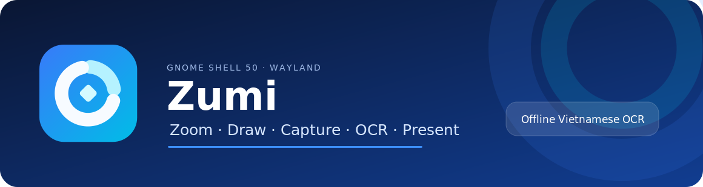
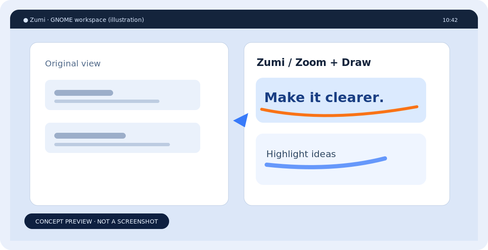
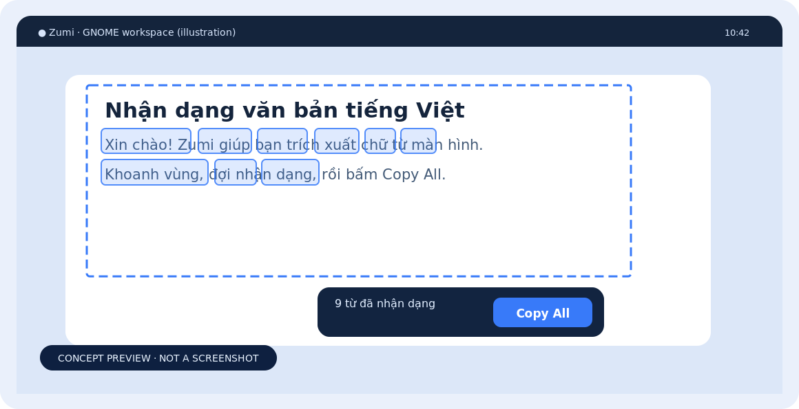
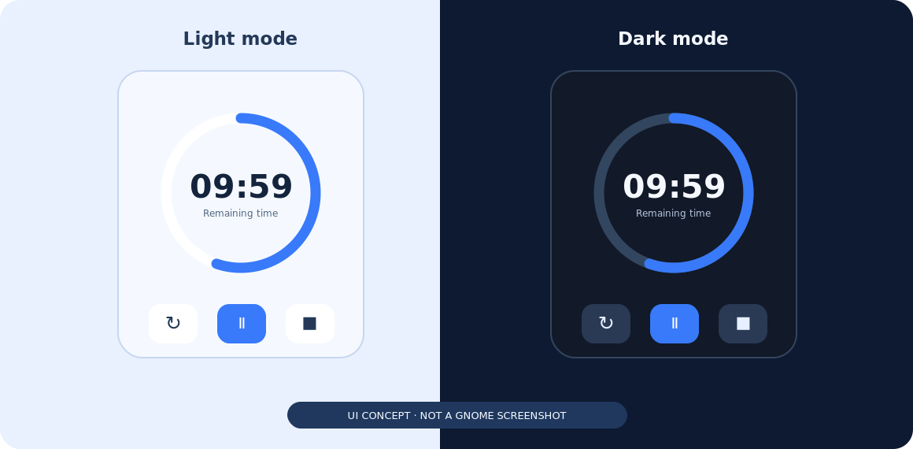

<div align="center">



# Zumi

**Bộ công cụ Zoom, vẽ và trích xuất chữ cho GNOME Shell 50 / Wayland.**

[English](README.md) · [Cài đặt](#cài-đặt) · [Phím tắt](#phím-tắt) · [Phát hành](#đóng-gói-để-phát-hành)

</div>

## Xem trước giao diện

| Zoom & Draw | Extract Text (OCR) |
|:---:|:---:|
|  |  |



> **Lưu ý:** Đây là hình minh họa dựa trên tính năng đã triển khai, **không phải ảnh chụp trực tiếp từ GNOME 50**. Có thể thay bằng screenshot thật khi thử nghiệm trên máy.

## Tính năng

- **Zoom:** Phóng to màn hình, chuyển mức phóng có animation, có Live Zoom.
- **Draw:** Bút vẽ, highlight, hình cơ bản, nhập văn bản (hỗ trợ bộ gõ tiếng Việt), Undo/Redo.
- **Countdown:** Đồng hồ nổi, vòng tiến trình xanh, tự theo giao diện Light/Dark hoặc chọn thủ công.
- **Cursor Highlight / Spotlight:** Làm nổi bật con trỏ và vùng đang trình bày.
- **Capture / Recording:** Chụp, lưu hoặc copy vùng chọn theo yêu cầu; quay màn hình bằng dịch vụ GNOME.
- **Extract Text:** OCR **tiếng Việt + tiếng Anh** bằng Tesseract chạy offline, giữ khung chọn, tô highlight chữ nhận diện, có nút **Copy All**.
- **DemoType:** Phát nội dung đoạn mẫu phục vụ trình bày.

**Tương thích:** Source hiện nhắm tới **GNOME Shell 50.x trên Wayland**. Không khẳng định hỗ trợ các phiên bản khác.

## Cài đặt

Giải nén hoặc clone project, mở Terminal trong thư mục gốc rồi chạy:

```bash
chmod +x scripts/*.sh
./scripts/install.sh
```

**Đăng xuất rồi đăng nhập lại GNOME Wayland** sau khi cập nhật, vì GNOME có thể giữ module JavaScript cũ trong bộ nhớ.

Kiểm tra:

```bash
gnome-extensions info lumalens@luanthnh.dev
./scripts/doctor.sh
```

Tên hiển thị là **Zumi**, nhưng UUID `lumalens@luanthnh.dev` được giữ để không mất thiết lập và phím tắt của bản cũ.

### Cài tiếng Việt OCR

Trên Ubuntu/Debian:

```bash
sudo apt update
sudo apt install tesseract-ocr tesseract-ocr-vie tesseract-ocr-eng
tesseract --list-langs
```

Cần thấy cả `vie` và `eng` trong danh sách ngôn ngữ. Tesseract hoạt động trên máy của bạn; Zumi không gửi screenshot đến dịch vụ OCR đám mây.

## Phím tắt

| Phím tắt | Tính năng |
| --- | --- |
| `Ctrl+1` | Static Zoom |
| `Ctrl+2` | Draw |
| `Ctrl+3` | Countdown |
| `Ctrl+4` | Live Zoom |
| `Ctrl+Shift+4` | LiveDraw |
| `Ctrl+5` | Bật/tắt quay màn hình |
| `Ctrl+Shift+5` | Quay vùng chọn |
| `Ctrl+Alt+5` | Quay cửa sổ |
| `Ctrl+Shift+6` | Khoanh vùng và lưu ảnh |
| `Ctrl+6` | Khoanh vùng và copy (cần bật tùy chọn) |
| `Ctrl+Alt+6` | Khoanh vùng nhận dạng chữ (cần bật tùy chọn) |
| `Ctrl+Alt+H` | Bật/tắt Cursor Highlight |
| `Ctrl+7` | DemoType |
| `Ctrl+8` | Quy trình quay Panorama |

Các phím tắt truy cập clipboard **mặc định tắt**. Bật trong Preferences hoặc dùng trực tiếp mục **Copy region / OCR region** từ menu tray. Xem danh sách đầy đủ tại **Keyboard shortcuts** trong menu này.

### Cách dùng Extract Text

1. Cài model OCR `vie` và `eng`.
2. Mở **OCR region** từ menu hoặc dùng phím tắt đã bật.
3. Khoanh vùng chữ cần lấy; Zumi giữ viền vùng chọn khi xử lý.
4. Xem highlight các từ nhận diện và bấm **Copy All**; `Esc` để hủy.

## Phát triển và kiểm tra

Máy phát triển có thể cài Node.js để chạy:

```bash
npm run verify
npm run ego:check
```

Node.js **không cần cài trên máy người dùng chỉ để chạy extension**. Unit test không thay thế việc kiểm thử thực tế trên GNOME Shell 50.

## Đóng gói để phát hành

ZIP source khác ZIP upload lên trang **extensions.gnome.org**. Gói upload cần URL GitHub/GitLab **thật**, không dùng đường dẫn giả:

```bash
ZUMI_REPOSITORY_URL=https://github.com/YOUR_GITHUB_USERNAME/zumi \
  ./scripts/pack-ego.sh
```

Thay đường dẫn ví dụ bằng URL repository của bạn. File đầu ra nằm ở `dist-ego/lumalens@luanthnh.dev.zip`. Xem [PUBLISHING.md](PUBLISHING.md) trước khi gửi duyệt.

## Lưu ý

- Panorama hiện là quy trình quay, chưa tự ghép ảnh panorama.
- Blur bằng công cụ `X` là dạng mosaic bảo vệ riêng tư, không phải Gaussian blur đầy đủ.
- Chưa có benchmark thực tế trên tất cả cấu hình GNOME 50.
- Project có sử dụng AI hỗ trợ phát triển; người phát hành cần hiểu và bảo trì được source.

**Giấy phép:** [GPL-3.0-or-later](LICENSE).
